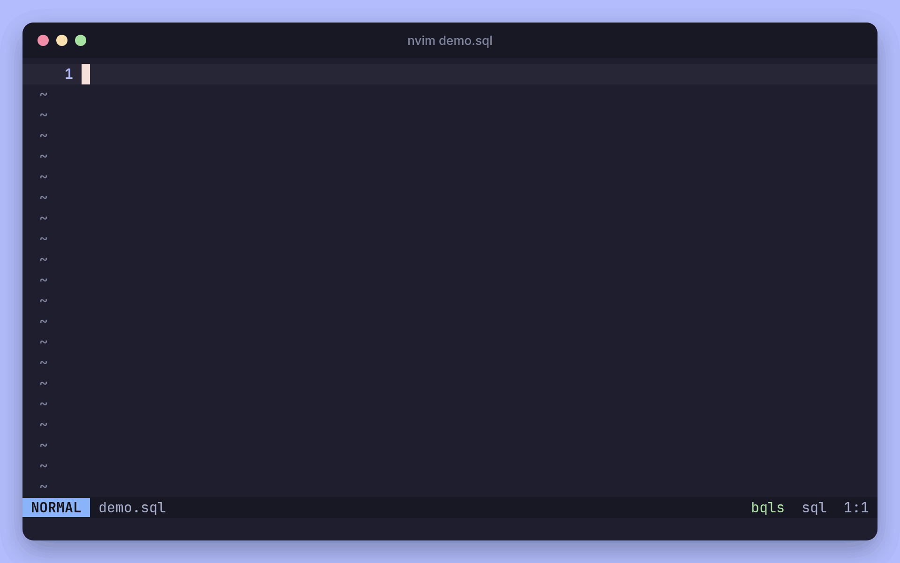

<div align="center">

<picture>
  <source media="(prefers-color-scheme: dark)" srcset="./docs/assets/logo-lockup-dark.svg">
  
</picture>

<br>

**The BigQuery Language Server**

Completion, hover, lint, and query execution for BigQuery SQL, right in your editor.

[](https://github.com/kitagry/bqls/actions/workflows/test.yml)
[](https://github.com/kitagry/bqls/actions/workflows/govulncheck.yml)
[](https://github.com/kitagry/bqls/releases/latest)
[](./go.mod)
[](https://marketplace.visualstudio.com/items?itemName=kitagry.bqls)
[](./LICENSE)

[Features](#-features) •
[Quick Start](#-quick-start) •
[Editor Setup](#%EF%B8%8F-editor-setup) •
[Lint](#lint) •
[Save Result](#save-result) •
[Supported Protocol](#supported-protocol)

</div>

<p align="center">
  
</p>

## ✨ Features

| | Feature | What you get |
| :---: | --- | --- |
| 💡 | **Completion** | Projects, datasets, tables, columns, `DECLARE` variables, keywords, and built-in functions, using your real BigQuery schemas |
| 📖 | **Hover** | Table schemas and metadata, column types and descriptions, and built-in function docs |
| 🎯 | **Go to definition** | Jump to CTEs and aliases, or open a table's details as a virtual document |
| 🩺 | **Diagnostics** | Analysis errors from the GoogleSQL analyzer as you type, checked against your table schemas |
| 💰 | **Dry-run cost estimate** | "This query will process 1.25 GiB when run." on save, before you spend anything |
| 🧹 | **Lint** | 35 rules for correctness, cost, and unused code, with quick fixes, `bqls:ignore` comments, a shared `.bqls.yaml`, and the [`bqls lint`](./docs/lint.md#cli) CLI for CI ([docs](./docs/lint.md)) |
| 🎨 | **Formatting** | Format BigQuery SQL with the GoogleSQL formatter |
| ▶️ | **Query execution** | Run or cancel queries and view the results in the editor ([`bqls.executeQuery`](./docs/api_reference.md#bqlsexecutequery)) |
| 🗂️ | **Explore** | Browse datasets, tables, and job histories ([`bqls.listDatasets`](./docs/api_reference.md#bqlslistdatasets), [`bqls.listTables`](./docs/api_reference.md#bqlslisttables), [`bqls.listJobHistories`](./docs/api_reference.md#bqlslistjobhistories)) |
| 📊 | **Save to Sheets** | Export query results to Google Sheets ([`bqls.saveResult`](./docs/api_reference.md#bqlssaveresult), see [Save Result](#save-result)) |

## 🚀 Quick Start

<a name="installation"></a>
<a name="install-from-releases"></a>

**1. Install**

Download the latest binary for Linux or macOS (amd64 / arm64) from [GitHub Releases](https://github.com/kitagry/bqls/releases/latest) and put it in your `PATH`, or install it with Go:

```bash
go install github.com/kitagry/bqls@latest
```

<a name="login-to-use-bigquery-api"></a>

**2. Log in to use the BigQuery API**

```bash
gcloud auth login
gcloud auth application-default login
```

If the credentials are missing or expire later, bqls shows this guidance instead of a raw BigQuery error. After you log in again, bqls picks up the new credentials without a restart.

**3. Set up your editor**

- **Neovim**: install [bqls.nvim](https://github.com/kitagry/bqls.nvim) and call `require("lspconfig").bqls.setup({})`. See [Neovim](#neovim).
- **VSCode**: install the [bqls extension](https://marketplace.visualstudio.com/items?itemName=kitagry.bqls). It downloads `bqls` for you on macOS and Linux. See [VSCode](#vscode).

<a name="prerequisites"></a>
<a name="build-from-source"></a>

<details>
<summary><b>Build from source</b></summary>

<br>

Prerequisites: Go 1.26 or later.

```bash
git clone https://github.com/kitagry/bqls.git
cd bqls
go install
```

</details>

## ⚙️ Editor Setup

<a name="settings"></a>

### Neovim

You can use [bqls.nvim](https://github.com/kitagry/bqls.nvim) to integrate BigQuery with Neovim.

You can specify your BigQuery Project ID and location in the configuration. If not specified, the plugin will use `gcloud config get project` for the Project ID and `US` as the default location.

```lua
require("lspconfig").bqls.setup({
  settings = {
    project_id = "YOUR_PROJECT_ID",
    location = "YOUR_LOCATION",
  },
})
```

<details>
<summary><b>Change settings at runtime with <code>workspace/didChangeConfiguration</code></b></summary>

<br>

You can change project_id with `workspace/didChangeConfiguration`.

```lua
vim.lsp.buf_notify(0, "workspace/didChangeConfiguration", { settings = { project_id = "ANOTHER_PROJECT_ID", location = "ANOTHER_LOCATION" } })
```

Settings omitted from the notification keep their current values, so you can send only what changed. A [`lint`](./docs/lint.md#editor-settings) setting, when sent, replaces the whole rule set; `lint = vim.empty_dict()` or `lint = vim.NIL` restores the defaults (a plain `{}` is encoded as a JSON array and rejected).

</details>

<details>
<summary><b>Async virtual text documents (for client authors)</b></summary>

<br>

`bqls` also supports fetching virtual document previews (table/job info) asynchronously so the
client isn't blocked while BigQuery is queried; see [`bqls/publishVirtualTextDocument`](./docs/api_reference.md#bqlspublishvirtualtextdocument)
in the API reference. This is opt-in via `supports_async_virtual_text_document` in
`initializationOptions`, so bqls.nvim keeps working unmodified until it adopts the new flow.

</details>

### VSCode

The official VSCode extension lives in [editors/vscode](./editors/vscode) in this repository and is published on the [Visual Studio Marketplace](https://marketplace.visualstudio.com/items?itemName=kitagry.bqls). See its [README](./editors/vscode/README.md) for settings such as `bqls.projectId`, `bqls.location`, and `bqls.lint.rules`.

You can also use the community extension [bqls-vscode](https://github.com/yokomotod/bqls-vscode).

## Lint

bqls reports lint findings (e.g. comparisons with NULL, missing partition filters, unused CTEs) as diagnostics for queries that analyze without errors, with quick fixes for some rules. `bqls lint` runs the same rules from the command line, e.g. in CI, and a `.bqls.yaml` shares the settings between your editor and CI.

```console
$ bqls lint --project my-project queries/
queries/report.sql:3:6: info: CTE `tmp` is defined but never used (unused-cte)
```

See [docs/lint.md](./docs/lint.md) for the list of [rules](./docs/lint.md#rules), [configuration](./docs/lint.md#configuration), and the [CLI](./docs/lint.md#cli).

## Save Result

In order to save for spreadsheet, you should enable Google Drive API.

1. Enable [Google Drive API](https://console.cloud.google.com/marketplace/product/google/drive.googleapis.com) and [Google Sheets API](https://console.cloud.google.com/marketplace/product/google/sheets.googleapis.com)
2. `gcloud auth application-default login --scopes=https://www.googleapis.com/auth/cloud-platform,https://www.googleapis.com/auth/drive`

## Supported Protocol

- textDocument/formatting
- textDocument/hover
- textDocument/completion
- textDocument/definition
- textDocument/codeAction
- [workspace/executeCommand](./docs/api_reference.md#workspaceexecutecommand)
    - [bqls.executeQuery](./docs/api_reference.md#bqlsexecutequery)
    - [bqls.cancelQuery](./docs/api_reference.md#bqlscancelquery)
    - [bqls.listProjects](./docs/api_reference.md#bqlslistprojects)
    - [bqls.listDatasets](./docs/api_reference.md#bqlslistdatasets)
    - [bqls.listTables](./docs/api_reference.md#bqlslisttables)
    - [bqls.searchTables](./docs/api_reference.md#bqlssearchtables)
    - [bqls.listJobHistories](./docs/api_reference.md#bqlslistjobhistories)
    - [bqls.saveResult](./docs/api_reference.md#bqlssaveresult)
    - bqls.listProjects
    - bqls.searchTables
- workspace/didChangeConfiguration
- [bqls/virtualTextDocument](./docs/api_reference.md#bqlsvirtualtextdocument)
- [bqls/publishVirtualTextDocument](./docs/api_reference.md#bqlspublishvirtualtextdocument)

## License

[Apache License 2.0](./LICENSE)
